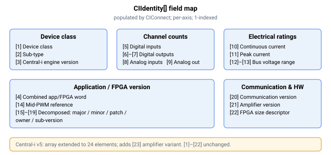

# CIIdentity

Per-axis array of identifying information returned by the connected Central-i device.

## Overview

`CIIdentity` is a read-only, axis-related array holding the identity and capability information that the connected Central-i device reports back to the master. The master fills it during the "get device" stage of [CIConnect](CIConnect.md) (and at [CIAutoConnect](CIAutoConnect.md)); before a successful connection its contents are not meaningful, and [CIDisconnect](CIDisconnect.md) clears it. It is not saved to flash. Index `[0]` is unused so the live fields start at index `[1]`.

## How it works

The elements describe the remote unit's class, firmware/FPGA versions, channel counts (how many digital and analog inputs/outputs it has), and the headline electrical ratings. Tools such as Agito PCSuite read these to present the correct interface for the connected device and to scale its I/O.



| Index | Field | Meaning |
|-------|-------|---------|
| [1] | Device class | Remote class as reported (amplifier / I/O / simulation) — see [CIDeviceType](CIDeviceType.md) |
| [2] | Device sub-type | Specific device variant within the class |
| [3] | Central-i engine version | Protocol-engine version in the remote |
| [4] | Application / FPGA version | Remote application/FPGA version word |
| [5] | Digital inputs | Number of digital input channels |
| [6] | Digital outputs | Number of digital output channels |
| [7] | Isolated digital outputs | Number of isolated digital output channels |
| [8] | Analog inputs | Number of analog input channels |
| [9] | Analog outputs | Number of analog output channels |
| [10] | Continuous-current rating | Max continuous current the device supports |
| [11] | Peak-current rating | Max peak current the device supports |
| [12] | Minimum bus voltage | Lower bus-voltage limit of the device |
| [13] | Maximum bus voltage | Upper bus-voltage limit of the device |
| [14] | Mid-PWM value | Device PWM mid-scale reference |
| [15] | App/FPGA version — major | Structured version: major |
| [16] | App/FPGA version — minor | Structured version: minor |
| [17] | App/FPGA version — patch | Structured version: patch |
| [18] | App/FPGA version — owner | Structured version: build owner field |
| [19] | App/FPGA version — sub-version | Structured version: sub-version |
| [20] | Communication version | Remote communication-layer version |
| [21] | Amplifier version | Amplifier firmware version |
| [22] | FPGA size | Remote FPGA size descriptor |

For a **simulated** device type, the master does not read a real remote; instead it writes default channel counts (elements [5]–[9]) so the host still sees a plausible interface.

The device's serial number, date code and detailed per-channel electrical calibration are read separately into the firmware's internal device table (not exposed through this array); `CIIdentity` carries the summary fields above.

## Examples

```text
ACIIdentity[1]      ; device class reported by the connected device
ACIIdentity[5]      ; number of digital inputs on the remote
ACIIdentity[8]      ; number of analog inputs on the remote
```

## Edge cases

- **Motor off / on / in motion.** Read-only; reading is permitted in any motor state.
- **Before connect / after [CIDisconnect](CIDisconnect.md).** Contents are zeroed and are not meaningful — wait for [CIStatus](CIStatus.md)`[1] = 3` before relying on the array.
- **Simulation device.** When [CIDeviceType](CIDeviceType.md) selects a simulation class, no real remote is read; the master writes default channel counts into `[5]`–`[9]` so host tooling still sees a plausible interface, and the remaining electrical/version fields stay zero.
- **Standalone product.** Central-i is the master-side feature; on a standalone controller there is no remote to identify.
- **Reconnect with a different device.** Changing [CIDeviceType](CIDeviceType.md) while connected forces a disconnect, which clears `CIIdentity`; the new identity is filled when the next [CIConnect](CIConnect.md) reaches the *Get device* stage.

## Changes between versions

v5 (the Central-i-only, 64-bit firmware) extends the array to 24 elements, adding one further field:

| Index | Field | Meaning |
|-------|-------|---------|
| [23] | Amplifier variant | Amplifier hardware-variant descriptor |

Elements [1]–[22] are unchanged from v4.

## See also

- [CIConnect](CIConnect.md) — populates this array on connect
- [CIDisconnect](CIDisconnect.md) — clears this array
- [CIStatus](CIStatus.md) — live link state
- [CIDeviceType](CIDeviceType.md) — locally configured (expected) port class

## FPGA capability snapshot (AGM800 / AGM800-EC)

Firmware that advertises a maximum index of 41 appends the following read-only fields; indices 1–23 keep their meanings. Older v5 images may end at 23: they do not provide this extension. Check live keyword metadata rather than assuming that every v5 image includes it.

| Index | Field | Meaning |
|---|---|---|
| [24]–[39] | FPGA FEATURES words 0–15 | Snapshot of remote registers 0x1F0–0x1FF; each value is an unsigned 16-bit word carried in int32 |
| [40] | Availability | 0 unavailable/pending; 1 validated; 2 absent; 3 invalid block or unsupported layout; 4 transport error |
| [41] | Generation | Nonnegative snapshot generation, changed on invalidation and publication |

The master discovers these words through its queued offline transport after connection, with bounded retries, and caches them per port. Reading these identity fields does not send a new offline feature-register request. Connection status alone does not imply capability discovery has completed. Disconnect, reset, reflash/reconnect and port reconfiguration invalidate the snapshot. Simulated devices do not advertise real FPGA capabilities.

Read generation and availability, then all sixteen words, then availability and generation again. Accept the snapshot only when both generations match, both availability values are 1, word 0 bit 15 is set, word 15 equals the 16-bit complement of word 0, and word 0 bits 11:8 identify supported layout 1. Otherwise treat capability as unknown/unavailable. A validated zero capability mask means unsupported. Generation is a consistency token, not a product version.

Word 1 describes main encoder support; word 2 describes auxiliary encoder support. Word 3 bit 13 advertises main raw-index output routing, and bit 14 advertises auxiliary raw-index output routing. Test those explicit routing bits before selecting [DOutSelect](../../05-inputs-outputs/05-digital-outputs/DOutSelect.md) 10/11. Encoder-presence bits alone do not establish routing support.

PCSuite must refresh cached keyword metadata after an unreleased firmware changes its array size. Normal released firmware versions use a new metadata-cache key. Saved parameter files cannot supply or overwrite capability identity.

