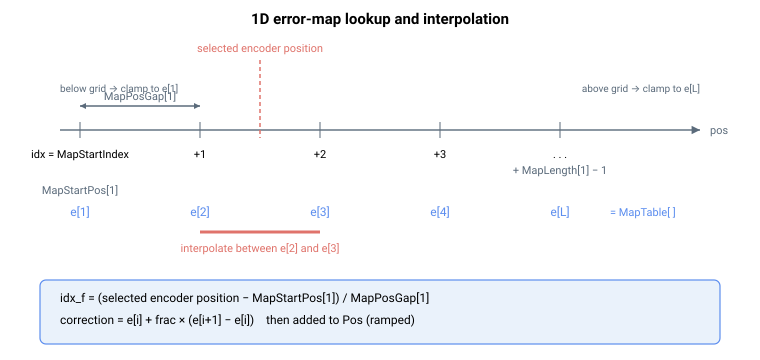

# MapTable/MapTableB/MapTableC/MapTableD/MapTableE

Arrays of position-error correction values used by error mapping.

## Overview

`MapTable` and its extended variants `MapTableB` through `MapTableE` are axis-scoped arrays that store the position-error correction values (in encoder counts) used by error mapping. At each map point — defined by [MapStartPos](MapStartPos.md), [MapPosGap](MapPosGap.md), and [MapLength](MapLength.md), for the map selected by [MapType](MapType.md) and the source chosen by [MapEncoder](MapEncoder.md) — the table holds the value to **add** to the feedback. The corrected result is [Pos](../10-motion/01-kinematics-status/Pos.md); the uncorrected value is [PosBeforeMap](PosBeforeMap.md), so `Pos − PosBeforeMap` is the (ramped) interpolated table value.

The five banks together form **one continuous, 1-based index space**: [MapStartIndex](MapStartIndex.md) and the per-dimension offsets address it as if it were a single array, and the firmware's fetch routine routes each index to the correct bank. The `B`–`E` banks exist only to extend total capacity — a map can begin in `MapTable` and run on into `MapTableB`, etc.

All variants are saved to flash and can be changed with the motor on, but not while the axis is in motion.



> **Quick Facts note.** The attributes block on this page describes `MapTable` (CAN 326; array size 1601 on standalone, 3001 on central-i, 60001 on the extended-flash central-i build). `MapTableB`–`MapTableE` are CAN 485–488 with array size `MAP_TABLE_SIZE_HUGE` (2 on standalone, 501 on central-i, 60001 on the extended-flash central-i build) and share `MapTable`'s access, flash, motor-on and in-motion attributes.

## How it works

### How a stored value becomes a correction

Each control cycle the controller turns the source encoder reading into a fractional index (see [MapPosGap](MapPosGap.md)), reads the bracketing table entries, and **linearly interpolates**:

$$
\text{correction} = e_i + \text{frac} \cdot (e_{i+1} - e_i)
$$

For 2D this is done bilinearly (4 entries), for 3D trilinearly (8 entries). The result, plus the [MapErrOffset](MapErrOffset.md) component, is scaled by the engage ramp and added to the uncorrected feedback ([PosBeforeMap](PosBeforeMap.md)) to form `Pos`. Outside the mapped range the value is **clamped** to the first or last entry (no extrapolation).

### Continuous index space and bank boundaries

Indexing is 1-based and the banks chain head-to-tail. The exact boundary index where each bank begins is **product-dependent** (the bank sizes differ between the standalone controller and central-i, and between flash configurations), but the *ordering* is fixed:

| Bank | Position in the index space |
|------|-----------------------------|
| `MapTable[1…]` | first bank — start of the table |
| `MapTableB[1…]` | immediately after the last `MapTable` entry |
| `MapTableC[1…]` | immediately after `MapTableB` |
| `MapTableD[1…]` | immediately after `MapTableC` |
| `MapTableE[1…]` | immediately after `MapTableD` |

In practice `MapTable` is the large bank on every build; `MapTableB…E` are small on the standalone controller and on the standard central-i image, and only become large under the extended-flash central-i configuration. Set [MapStartIndex](MapStartIndex.md) and [MapLength](MapLength.md) so the whole map fits within the combined capacity from the start index onward.

## Examples

```text
AMapTable[1]=12      ; correction value at the first map point (encoder counts)
AMapTable[1]         ; read the correction at the first map point
AMapTableB[1]        ; read the first entry of the second bank
```

### Edge cases

- **Index 0** — invalid; valid indices are `[1…N]` where `N` is the bank size.
- **Motor on / in motion at write** — accepted with the motor on at standstill; rejected while the axis is in motion (error 21).
- **Out of range index** — rejected by the parameter table; refer to the product's bank sizes.
- **Mapping off** ([MapType](MapType.md) = 0) — the tables are stored but not consulted.
- **Simulation motor** — mapping is skipped entirely; tables are stored but produce no correction.
- **Beyond mapped range** — readings outside `[MapStartPos, MapStartPos + (MapLength − 1) × MapPosGap]` clamp to the boundary entry; no extrapolation.
- **Encoder counts only** — units are pre-correction encoder counts of the source [MapEncoder](MapEncoder.md), not user units.
- **Save** — flash-saveable; large tables persist across reboots.

> **Changing the map with the motor on.** A write at standstill takes effect on the next control sample. Because the map corrects the feedback ([Pos](../10-motion/01-kinematics-status/Pos.md)), the corrected position can step once, and the servo moves the axis by that step. To make the change gradual instead (the axis still moves by the whole correction, once as it ramps out and again as it ramps in), first set a small [MapErrOnStep](MapErrOnStep.md) (the ramp takes `16384 / MapErrOnStep` cycles, so e.g. `16` gives about 1024 cycles; `0`, the default, and `16384` switch the whole correction in one cycle, which is itself a step), then set [MapType](MapType.md) = `0`, wait for the disengage ramp to finish (about `16384 / MapErrOnStep` control cycles; `Pos` equalling `PosBeforeMap` is not a reliable sign, because a small correction can read 0 while the ramp is still running), change the map, and switch `MapType` back on so the correction ramps back in. A non-zero [MapErrOffset](MapErrOffset.md) is forced to 0 while mapping is off and slews back in at [MapErrOffRamp](MapErrOffRamp.md). Writes are refused while the axis is in motion (error 21). On firmware before this change, writes with the motor on are refused (error 22).

## See also

- [MapType](MapType.md) — enables mapping and selects 1D/2D/3D
- [MapStartPos](MapStartPos.md) — start position of each map dimension
- [MapLength](MapLength.md) — number of points per dimension
- [MapPosGap](MapPosGap.md) — spacing between points
- [MapEncoder](MapEncoder.md) — encoder source per dimension
- [MapStartIndex](MapStartIndex.md) — table index where the active map begins
- [PosBeforeMap](PosBeforeMap.md) — feedback position before these corrections are applied
