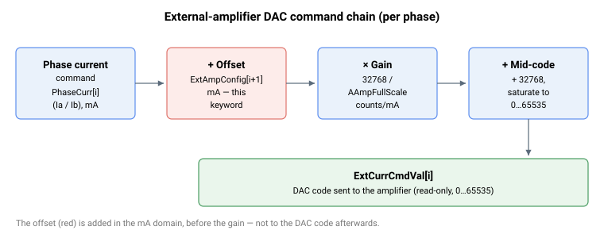

# ExtAmpConfig

Current-feedback scale and per-phase command and feedback offsets for external amplifiers.

The five entries configure an axis connected through a Central-i ADP03, ADP04 or ADP05 external-amplifier adapter. The keyword accepts raw floating-point values. Save the configuration to retain it across power cycles.

| Index | Setting | Unit or interpretation | Default |
| --- | --- | --- | --- |
| 1 | Current-feedback scale, both phases | Raw scale factor. Each ADC count corresponds to this many mA. The sign sets the feedback polarity. | 0 in a default parameter set. At adapter power-up, a zero is initialized to −1.049041748046875. |
| 2 | Phase A command offset | mA added before DAC gain | 0 mA |
| 3 | Phase B command offset | mA added before DAC gain | 0 mA |
| 4 | Phase A feedback zero offset | mA subtracted after feedback scaling | 0 mA |
| 5 | Phase B feedback zero offset | mA subtracted after feedback scaling | 0 mA |

An existing nonzero scale is retained at adapter power-up. On ADP05, each phase uses its own feedback offset. An offset of +25 mA subtracts 25 mA from that phase’s scaled reading.

On the external SPI command path, a gain of 8 DAC counts/mA and a phase A command offset of +250 mA shift the unsaturated DAC code by +2000 counts. Read the transmitted code with [ExtCurrCmdVal](ExtCurrCmdVal.md). The gain follows [AAmpFullScale](../../02-motor-and-amplifier/AAmpFullScale.md).



```text
AExtAmpConfig[1]
AExtAmpConfig[2]=250
AExtAmpConfig[3]=-100
```
