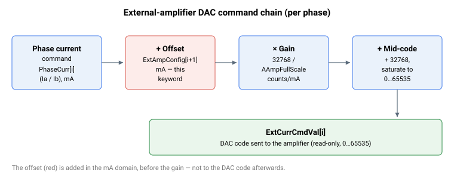

# ExtAmpConfig

外部功率放大器的电流反馈比例及各相指令、反馈偏置。

这五个元素用于配置经 Central-i ADP03、ADP04 或 ADP05 适配器连接外部功率放大器的轴。关键字直接接收浮点数值。保存配置后，设置可在重新上电时恢复。

| 索引 | 参数 | 单位或含义 | 默认值 |
| --- | --- | --- | --- |
| 1 | 两相共用的电流反馈比例 | 直接输入比例系数。ADC 每变化一个计数，反馈电流变化相应的 mA 数。符号决定反馈极性。 | 参数默认值为 0。适配器上电时，若该值为 0，则设为 −1.049041748046875。 |
| 2 | A 相指令偏置 | mA，在应用 DAC 增益前加到指令上 | 0 mA |
| 3 | B 相指令偏置 | mA，在应用 DAC 增益前加到指令上 | 0 mA |
| 4 | A 相反馈零点偏置 | mA，反馈换算为电流后减去此值 | 0 mA |
| 5 | B 相反馈零点偏置 | mA，反馈换算为电流后减去此值 | 0 mA |

若已设置非零比例，适配器上电时会保留该值。在 ADP05 上，两相分别使用各自的反馈偏置。若一相设置 +25 mA，换算后的该相反馈电流将减去 25 mA。

在外部 SPI 指令路径上，若增益为每 mA 对应 8 个 DAC 计数，A 相指令偏置为 +250 mA，则饱和处理前的 DAC 码增加 2000 个计数。可通过 [ExtCurrCmdVal](ExtCurrCmdVal.zh.md) 读取已发送的码值。有关增益，参见 [AAmpFullScale](../../02-motor-and-amplifier/AAmpFullScale.zh.md)。



```text
AExtAmpConfig[1]
AExtAmpConfig[2]=250
AExtAmpConfig[3]=-100
```
