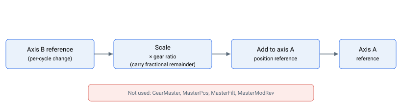

# MotionMode = 10 — Direct slave motion

In direct slave motion, axis A follows changes in axis B’s position reference. Firmware with the fractional tracking fix uses the reduced ratio from [MasterFact](MasterFact.md) and [MasterFactDen](MasterFactDen.md). The master is always axis B on supported multi-axis products.



## How it works

### Per-cycle update

From each sample to the next, the controller scales axis B’s reference change by the configured ratio and carries the fractional remainder forward. Over an interval with one ratio, the ideal change in axis A’s reference is

$$
\Delta_{\text{PosRef A, ideal}} = \frac{\text{MasterFact}}{\text{MasterFactDen}} \cdot \Delta_{\text{PosRef B}}
$$

Axis A follows the nearest whole internal reference unit. At an exact half unit it takes the greater integer. The residual stays within half an internal reference unit as the direction reverses. A negative numerator reverses the follower direction.

### Begin

Issuing [Begin](../04-motion-command/Begin.md) with `MotionMode = 10`:

- snapshots axis B’s current reference and clears axis A’s remainder. Leaving mode 10 or changing the reduced ratio also clears the remainder. Rewriting an equivalent ratio retains it.
- starts the motion immediately (no `BeginDInOn` arming path is honoured for this mode);
- marks axis A as in motion.

The mode does not run a kinematic profiler, so it is not subject to [Speed](../03-kinematics-configuration/Speed.md), [Accel](../03-kinematics-configuration/Accel.md), [Decel](../03-kinematics-configuration/Decel.md) limits. Software position limits ([FwdPLim](../../06-protections/03-motion/position-limit-protection/FwdPLim.md), [RevPLim](../../06-protections/03-motion/position-limit-protection/RevPLim.md)) are also **not** clamped inside this mode — the follower reference is built directly from axis B's reference change each cycle. Plan the motion accordingly.

### Ending the motion

The mode stays in motion until the axis is disabled or a new `MotionMode` is set; if the master (axis B) stops moving, the follower reference simply stops changing while the axis remains in motion. Unlike direct gear motion ([MotionMode](../02-motion-configuration/MotionMode.md) `= 5`) — which ends the motion immediately when a `Stop`/`Abort` is requested (a controlled stop additionally turns the motor off and logs the controlled-stop fault) — this mode does not act on `Stop`/`Abort` at all: the follower keeps tracking axis B. To end it, disable the slave axis or set a new `MotionMode` after the motion has ended.

## Availability and restrictions

- **Multi-axis builds only.** The mode requires axis B to exist; on single-axis builds it is not active.
- **Hard-wired master/slave assignment.** Axis A is the slave; axis B is the master. The mode is not (yet) generalised to arbitrary axis pairs.
- **No `Stop`/`Abort` handling.** Use motor-off or a `MotionMode` change after motion completion.
- **No software-limit clamping.** The follower reference is not bounded by `FwdPLim`/`RevPLim` inside this mode.
- **No filter and no master accumulator.** Compare with direct gear motion ([MotionMode](../02-motion-configuration/MotionMode.md) `= 5`), which routes the master through `MasterPos` and `MasterFilt`.

## How it differs from direct gear motion

| Aspect | Direct slave (`MotionMode = 10`) | Direct gear (`MotionMode = 5`) |
|---|---|---|
| Master selection | Hard-wired to axis B's reference | Any variable, via [GearMaster](GearMaster.md) |
| Slave axis | Hard-wired to axis A | The commanded axis |
| Ratio | [MasterFact](MasterFact.md) / [MasterFactDen](MasterFactDen.md), with a carried remainder on firmware with the tracking fix | [MasterFact](MasterFact.md) / [MasterFactDen](MasterFactDen.md), with remainder carry in v5 |
| Master accumulator | None (no [MasterPos](MasterPos.md)) | [MasterPos](MasterPos.md) accumulates each cycle |
| Smoothing filter | None (no [MasterFilt](MasterFilt.md)) | First-order low-pass via [MasterFilt](MasterFilt.md) |
| Modulo handling | None (no [MasterModRev](MasterModRev.md)) | [MasterModRev](MasterModRev.md) wraps the master |
| Software limits | Not clamped inside this mode | Clamped by [FwdPLim](../../06-protections/03-motion/position-limit-protection/FwdPLim.md) / [RevPLim](../../06-protections/03-motion/position-limit-protection/RevPLim.md) |
| `Stop` / `Abort` handling | Ignored — motion continues | Ends the motion immediately (no deceleration ramp) |

If you need any of the gear-motion features (a configurable master, smoothing, modulo wrap, software limits or a controlled stop), use direct or indirect gear motion ([MotionMode](../02-motion-configuration/MotionMode.md) `= 5` or `= 6`) instead.

## Changes between versions

The following table describes firmware before the fractional tracking fix. Both versions scale axis B’s position-reference change before adding it to axis A’s reference.

| | v4 (standalone &amp; central-i) | v5 (central-i) |
|---|---|---|
| Ratio applied | `MasterFact / 65536` as an integer quotient | `MasterFact` interpreted as a floating-point ratio, applied without the integer shift |
| Per-cycle rounding | Truncation in the integer quotient | Rounded floating-point multiply |

**v5 is central-i only.** Both versions hard-wire axis A as the slave and axis B as the master.

## Examples

```text
; --- Axis A follows axis B at 7:13 on firmware with fractional tracking ---
AMasterFact=7
AMasterFactDen=13
AMotionMode=10        ; 10 = direct slave (axis A follows axis B)
ABegin                ; latches axis B reference; A now tracks dB each cycle

; --- Read axis A's reference while axis B moves ---
APosRef               ; reads the current follower reference

; --- End the motion by disabling the slave axis ---
AMotorOn=0            ; disable the slave; this mode does not honour Stop/Abort
```

With this configuration, a net change of 13 internal reference units on axis B adds 7 units to axis A. Changing the numerator to −7 reverses the direction.

## See also

- [MotionMode](../02-motion-configuration/MotionMode.md) — selects the type of motion (this is value `10`)
- [MasterFact](MasterFact.md) and [MasterFactDen](MasterFactDen.md) — numerator and denominator
- [GearMaster](GearMaster.md) — **not** used by this mode (used by `MotionMode = 5` / `= 6`)
- [MasterPos](MasterPos.md), [MasterFilt](MasterFilt.md), [MasterModRev](MasterModRev.md) — gear-motion only; not used by this mode
- [PosRef](../01-kinematics-status/PosRef.md) — the reference this mode drives directly
- [Begin](../04-motion-command/Begin.md) — starts the motion
