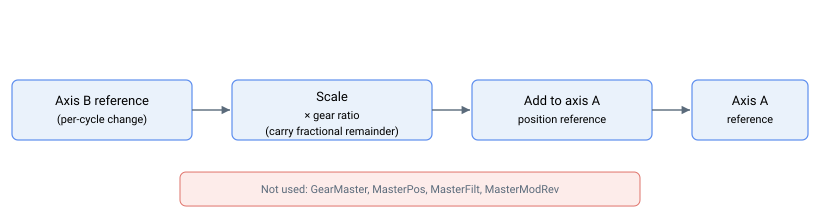

# MotionMode = 10 — 直接从动运动

在直接从轴运动模式下，轴 A 跟随轴 B 的位置参考变化。含小数余量跟踪修复的固件使用 [MasterFact](MasterFact.md) 与 [MasterFactDen](MasterFactDen.md) 的约分比值。在支持此模式的多轴产品上，主轴固定为轴 B。



## 工作原理

### 逐周期更新

控制器按设定比值缩放每个采样周期内轴 B 的参考变化，并将小数余量保留到下一周期。在比值固定的区间内，轴 A 参考值的理想变化量为

$$
\Delta_{\text{PosRef A, ideal}} = \frac{\text{MasterFact}}{\text{MasterFactDen}} \cdot \Delta_{\text{PosRef B}}
$$

轴 A 的参考变化量按内部参考单位取最近整数。恰好位于半单位时取较大的整数。运动反向时，余量仍在半个内部参考单位以内。分子为负时，从轴方向反转。

### Begin

以 `MotionMode = 10` 发出 [Begin](../04-motion-command/Begin.md)：

- 记录轴 B 的当前参考值并清除轴 A 的余量。退出模式 10 或更改约分后的比值也会清除余量。写入等值比值会保留余量。
- 立即开始运动（该模式不响应 `BeginDInOn` 的触发路径）；
- 将轴 A 标记为运动中。

该模式不运行运动学规划器，因此不受 [Speed](../03-kinematics-configuration/Speed.md)、[Accel](../03-kinematics-configuration/Accel.md)、[Decel](../03-kinematics-configuration/Decel.md) 限值的约束。软件位置限位（[FwdPLim](../../06-protections/03-motion/position-limit-protection/FwdPLim.md)、[RevPLim](../../06-protections/03-motion/position-limit-protection/RevPLim.md)）在该模式内也**不**进行钳位——从动轴参考值直接由每周期轴 B 的参考变化量构建。请据此规划运动。

### 结束运动

该模式保持运动状态直至轴被禁用或设置了新的 `MotionMode`；若主轴（轴 B）停止运动，从动轴参考值将停止变化，而轴仍处于运动中状态。与直接齿轮运动（[MotionMode](../02-motion-configuration/MotionMode.md) `= 5`）不同——后者在请求 `Stop`/`Abort` 时立即结束运动（受控停止还会额外关闭电机并记录受控停止故障）——该模式对 `Stop`/`Abort` 完全不响应：从动轴持续跟踪轴 B。如需结束该模式，请在运动结束后禁用从动轴或设置新的 `MotionMode`。

## 可用性与限制

- **仅限多轴构建。** 该模式要求轴 B 存在；在单轴构建中不可用。
- **主从轴分配硬性固定。** 轴 A 为从动轴；轴 B 为主轴。该模式尚未推广至任意轴对。
- **不响应 `Stop`/`Abort`。** 使用电机关闭或在运动结束后更改 `MotionMode`。
- **无软件限位钳位。** 从动轴参考值在该模式内不受 `FwdPLim`/`RevPLim` 约束。
- **无滤波器，无主轴累加器。** 与直接齿轮运动（[MotionMode](../02-motion-configuration/MotionMode.md) `= 5`）相比，后者将主轴信号经 `MasterPos` 和 `MasterFilt` 处理。

## 与直接齿轮运动的区别

| 方面 | 直接从动（`MotionMode = 10`） | 直接齿轮（`MotionMode = 5`） |
|---|---|---|
| 主轴选择 | 硬性绑定至轴 B 的参考值 | 任意变量，通过 [GearMaster](GearMaster.md) 选择 |
| 从动轴 | 硬性绑定至轴 A | 被指令的轴 |
| 比值 | [MasterFact](MasterFact.md) / [MasterFactDen](MasterFactDen.md)，含跟踪修复的固件会保留余量 | [MasterFact](MasterFact.md) / [MasterFactDen](MasterFactDen.md)，v5 保留余量 |
| 主轴累加器 | 无（无 [MasterPos](MasterPos.md)） | [MasterPos](MasterPos.md) 每周期累积 |
| 平滑滤波器 | 无（无 [MasterFilt](MasterFilt.md)） | 通过 [MasterFilt](MasterFilt.md) 实现一阶低通 |
| 取模处理 | 无（无 [MasterModRev](MasterModRev.md)） | [MasterModRev](MasterModRev.md) 对主轴进行环绕处理 |
| 软件限位 | 该模式内不进行钳位 | 由 [FwdPLim](../../06-protections/03-motion/position-limit-protection/FwdPLim.md) / [RevPLim](../../06-protections/03-motion/position-limit-protection/RevPLim.md) 钳位 |
| `Stop` / `Abort` 响应 | 忽略——运动继续 | 立即结束运动（无减速斜坡） |

若需要任何齿轮运动功能（可配置主轴、平滑、取模环绕、软件限位或受控停止），请改用直接或间接齿轮运动（[MotionMode](../02-motion-configuration/MotionMode.md) `= 5` 或 `= 6`）。

## 版本间变更

下表描述小数余量跟踪修复之前的固件。两个版本均先缩放轴 B 的位置参考变化量，再累加到轴 A 的参考值。

| | v4（独立版本 &amp; central-i） | v5（central-i） |
|---|---|---|
| 应用的比值 | `MasterFact / 65536` 作为整数商 | `MasterFact` 解释为浮点比值，不进行整数移位应用 |
| 逐周期舍入 | 整数商的截断 | 四舍五入的浮点乘法 |

**v5 仅适用于 central-i。** 两个版本均硬性将轴 A 作为从动轴，轴 B 作为主轴。

## 示例

```text
; --- 含小数跟踪修复的固件：轴 A 以 7:13 跟随轴 B ---
AMasterFact=7
AMasterFactDen=13
AMotionMode=10        ; 10 = direct slave (axis A follows axis B)
ABegin                ; latches axis B reference; A now tracks dB each cycle

; --- Read axis A's reference while axis B moves ---
APosRef               ; 读取当前从轴参考值

; --- End the motion by disabling the slave axis ---
AMotorOn=0            ; disable the slave; this mode does not honour Stop/Abort
```

按上述配置，轴 B 的净变化量为 13 个内部参考单位时，轴 A 增加 7 个单位。将分子改为 −7 可反转方向。

## 另请参阅

- [MotionMode](../02-motion-configuration/MotionMode.md) — 选择运动类型（此为值 `10`）
- [MasterFact](MasterFact.md) 和 [MasterFactDen](MasterFactDen.md) — 分子与分母
- [GearMaster](GearMaster.md) — 该模式**不**使用（由 `MotionMode = 5` / `= 6` 使用）
- [MasterPos](MasterPos.md)、[MasterFilt](MasterFilt.md)、[MasterModRev](MasterModRev.md) — 仅用于齿轮运动；该模式不使用
- [PosRef](../01-kinematics-status/PosRef.md) — 该模式直接驱动的参考值
- [Begin](../04-motion-command/Begin.md) — 启动运动
