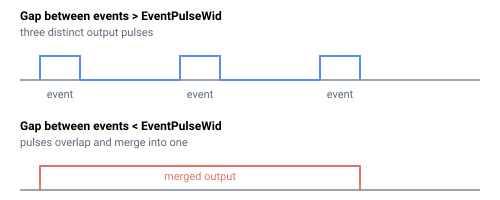

# EventPulseWid

Duration of the event output pulse in microseconds.

## Overview

`EventPulseWid` sets the duration of the event output pulse, determining how long the output signal stays active after each event trigger. The width is expressed in microseconds by default, or in nanoseconds if [EventPulseRes](EventPulseRes.md) = 1. With small [EventGap](EventGap.md) values at high velocity, a large pulse width can cause successive pulses to overlap. Per-entry overrides for table-driven events are set with [EventTableWid](EventTableWid.md). It is an axis-related parameter saved to flash and can be changed at any time.

## How it works

The sign and magnitude of the value control the output:

| Value | Output behavior |
|-------|-----------------|
| Positive | A pulse of that duration with normal polarity (output drives active, then returns to idle). |
| 0 | Toggle mode: the output changes state at each event instead of producing a fixed-duration pulse. |
| Negative | A pulse of that magnitude (duration) with inverted polarity. |

When events are armed, the controller converts the width into the pulse generator's internal timebase, automatically choosing a coarse or fine internal time step so that both short and long pulses are timed accurately. Because the pulse has a fixed duration in time (not in position), the *distance* the axis travels during the pulse grows with velocity. The diagram shows how successive pulses can overlap when the time the axis takes to cross [EventGap](EventGap.md) is shorter than the pulse width:



Central-i masters round the requested width to the nearest timer step. At a remote clock of 100 MHz the fine step is **20 ns** for widths up to about 163.8 µs, and the coarse step is **5.12 µs** for longer widths. Stand-alone products use a different timer with a shorter maximum and round down to the timer step.

On AGM800 and AGM800-EC firmware containing the software-table width fix, a streamed table (`EventType=2` with incremental or hardware SIN-COS feedback) limits the first and every subsequent pulse to **41.93792 ms** (8,191 coarse steps). The limit applies to the magnitude of both explicit and inherited widths. An inherited negative width keeps its inverted polarity. A first table entry set to zero still selects toggle mode. Other event modes retain their own limits. The 18-bit arming format can encode up to about 1.34 s, subject to the remote hardware. [Firmware-Main #2675](https://github.com/akribis-agito/Firmware-Main/pull/2675)

**5.3.0-rc7 compatibility.** The first streamed table row used the 18-bit arming format. Later rows sent only the low 13 bits of the converted width. For example, a later 50 ms request encoded about 8.06 ms. Keep streamed widths within 41.93792 ms on that firmware.

### AGM800 prepared hardware tables

For EventLoad-managed `EventType=3`, the effective width after the existing fine/coarse conversion must fit the current 13-bit hardware field (1–8191 units; an effective width of 0 is accepted only on the first selected row, where it selects toggle mode). A value outside that field fails preparation before arm; the preload path does not silently truncate or apply the larger-width clamping described for other paths. Other event types retain their existing behavior.


## Examples

```text
AEventPulseWid=50    ; 50 us output pulse (default unit)
AEventPulseWid=-50   ; 50 us pulse, inverted polarity
AEventPulseWid=0     ; toggle the output at each event instead of pulsing
AEventPulseWid       ; query the current pulse width
```

## See also

- [EventPulseRes](EventPulseRes.md) — selects the pulse-width time unit (microseconds or nanoseconds)
- [EventTableWid](EventTableWid.md) — per-entry pulse width override
- [EventGap](EventGap.md) — small gaps with wide pulses can overlap
