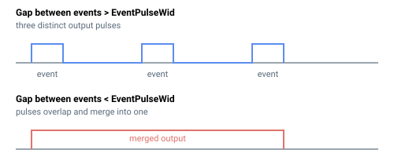

# EventPulseWid

Duration of the event output pulse in microseconds.

## Verified hardware table (EventType=3 with an EventLoad session)

Widths are converted using the advertised remote CLOCK_HZ with checked 64-bit arithmetic. Choose a 2-clock quantum when the nearest rounded count fits 18 bits; otherwise use 512 clocks. Ties round upward. Refuse overflow or a positive width that quantizes to zero; do not silently clamp. At 100 MHz these quanta are 20 ns and 5.12 μs. The realized width is count×quantum/CLOCK_HZ; this arithmetic is not an electrical accuracy claim. Pulse width plus recovery must fit target spacing: an early target faults rather than producing a delayed pulse. Session polarity/mode and all selected widths are frozen by EventLoad, so an edit requires a new load. Toggle Complete may retain its final level until explicit EventAbort.

The remaining legacy behavior below also applies to EventType=3 when no verified-table session owns the axis. The verified-table capability gates EventLoad, not legacy hardware-table arming.

## Overview

`EventPulseWid` sets the duration of the event output pulse, determining how long the output signal stays active after each event trigger. The width is expressed in microseconds by default, or in nanoseconds if [EventPulseRes](EventPulseRes.md) = 1. With small [EventGap](EventGap.md) values at high velocity, a large pulse width can cause successive pulses to overlap. Per-entry overrides for table-driven events are set with [EventTableWid](EventTableWid.md). It is an axis-related parameter saved to flash and can be changed at any time.

## How it works

The sign and magnitude of the value control the output:

| Value | Output behavior |
|-------|-----------------|
| Positive | A pulse of that duration with normal polarity (output drives active, then returns to idle). |
| 0 | Toggle mode: the output changes state at each event instead of producing a fixed-duration pulse. |
| Negative | A pulse of that magnitude (duration) with inverted polarity. |

When events are armed, the controller converts the width into the pulse generator's internal timebase, automatically choosing a coarse or fine internal time step so that both short and long pulses are timed accurately. Because the pulse has a fixed duration in time (not in position), the *distance* the axis travels during the pulse grows with velocity. The diagram shows how successive pulses can overlap when the time the axis takes to cross [EventGap](EventGap.md) is shorter than the pulse width:



The output duration is produced by a hardware timer, so the width is quantized to the timer step. On central-i remote drives with incremental or SIN-COS feedback this is about **20 ns** for pulses up to roughly **163.8 us**, and **5.12 us** for longer pulses, up to a maximum of about **1.34 seconds**; stand-alone products use a different timer with a shorter maximum. Requested widths are quantized to the timer step: central-i masters round to the nearest step, so up to about **41.9 ms** the same width gives the same pulse whether it is armed with the sequence or loaded for a later table point (a table point loaded later is limited to about 41.9 ms; the first pulse reaches the 1.34 s maximum), and stand-alone products truncate toward the nearest lower step. A width that exceeds the longest producible pulse is clamped to that maximum.

## Examples

```text
AEventPulseWid=50    ; 50 us output pulse (default unit)
AEventPulseWid=-50   ; 50 us pulse, inverted polarity
AEventPulseWid=0     ; toggle the output at each event instead of pulsing
AEventPulseWid       ; query the current pulse width
```

## See also

- [EventPulseRes](EventPulseRes.md) — selects the pulse-width time unit (microseconds or nanoseconds)
- [EventTableWid](EventTableWid.md) — per-entry pulse width override
- [EventGap](EventGap.md) — small gaps with wide pulses can overlap
