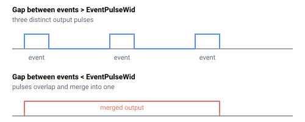

# EventPulseWid

事件输出脉冲的持续时间，单位为微秒。

## 概述

`EventPulseWid` 设置事件输出脉冲的持续时间，决定每次事件触发后输出信号保持有效的时长。默认情况下宽度以微秒表示，若 [EventPulseRes](EventPulseRes.md) = 1 则以纳秒表示。在高速度下使用较小的 [EventGap](EventGap.md) 时，较大的脉冲宽度可能导致相邻脉冲重叠。表驱动事件的每项覆盖值由 [EventTableWid](EventTableWid.md) 设置。该参数是轴相关参数，保存至闪存，可随时更改。

## 工作原理

值的符号和大小控制输出行为：

| 值 | 输出行为 |
|-------|-----------------|
| 正值 | 该持续时间的脉冲，极性正常（输出驱动为有效，然后返回空闲）。 |
| 0 | 切换模式：每次事件时输出改变状态，而不是产生固定持续时间的脉冲。 |
| 负值 | 该绝对值（持续时间）的脉冲，极性反转。 |

使能事件时，控制器将宽度转换为脉冲生成器的内部时基，自动选择粗步长或细步长内部时间步，使短脉冲和长脉冲均能精确计时。由于脉冲持续时间固定（而非固定位置长度），轴在脉冲期间移动的*距离*随速度增大而增大。下图展示了当轴跨越 [EventGap](EventGap.md) 所需时间短于脉冲宽度时，相邻脉冲如何重叠：



Central-i 主控将请求的脉宽舍入到最接近的定时器步长。远端时钟为 100 MHz 时，约 163.8 µs 以内的脉宽采用 **20 ns** 细步长，更长的脉宽采用 **5.12 µs** 粗步长。独立产品使用不同的定时器，最大脉宽较短，并按定时器步长向下取整。

对于包含软件表脉宽修复的 AGM800 和 AGM800-EC 固件，使用增量式反馈或硬件 SIN-COS 反馈的逐点加载软件表（`EventType=2`）将首行及后续各行的脉宽上限统一为 **41.93792 ms**（8,191 个粗步长）。此上限同时适用于显式设置和继承的脉宽绝对值。继承的负脉宽仍使用反向极性。将表的起始条目设为零仍会选择切换模式。其他事件模式各有其脉宽限制。18 位使能格式最多可编码约 1.34 秒，实际范围取决于远端硬件。[Firmware-Main #2675](https://github.com/akribis-agito/Firmware-Main/pull/2675)

**5.3.0-rc7 兼容性说明。** 逐点加载的软件表在首行使用 18 位使能格式，后续行仅发送转换后脉宽的低 13 位。例如，后续行请求 50 ms 时，编码后的脉宽约为 8.06 ms。使用该版本固件时，请将逐点加载的软件表脉宽保持在 41.93792 ms 以内。

### AGM800 已准备的硬件表

对于由 EventLoad 管理的 `EventType=3`，有效宽度经过原有细或粗分辨率转换后，必须能装入当前 13 位硬件字段（1–8191 个单位；有效宽度为 0 仅在首个所选行上被接受，此时选择翻转模式）。超出该字段的值会在使能前导致准备失败；预加载路径不会静默截断，也不使用其他路径所述的更大宽度钳位。其他事件类型保持原有行为。


## 示例

```text
AEventPulseWid=50    ; 50 us 输出脉冲（默认单位）
AEventPulseWid=-50   ; 50 us 脉冲，极性反转
AEventPulseWid=0     ; 每次事件时切换输出，而非脉冲
AEventPulseWid       ; 查询当前脉冲宽度
```

## 另请参阅

- [EventPulseRes](EventPulseRes.md) — 选择脉冲宽度时间单位（微秒或纳秒）
- [EventTableWid](EventTableWid.md) — 每项脉冲宽度覆盖值
- [EventGap](EventGap.md) — 间距较小且脉冲较宽时可能发生重叠
