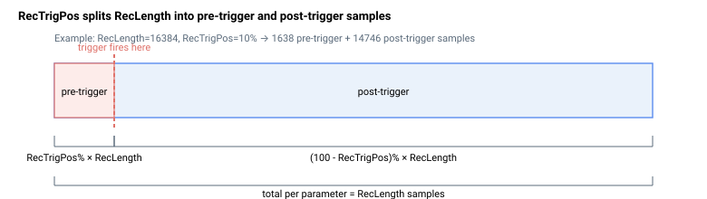

# RecTrigPos

Percentage of RecLength captured before the trigger (pre-trigger data).

## Overview

`RecTrigPos` defines the percentage of data points, out of [RecLength](RecLength.md), to capture before the trigger condition(s) activate. It is normally used during debugging to allow monitoring of the data leading up to the trigger event. Each array index selects a scope. Valid values are 0 to 100; [RecStart](RecStart.md) rejects the request with error 71 if the value is outside this range.



| Index | Descriptions                 |
|-------|------------------------------|
| 1     | First scope                  |
| 2     | Second scope (if applicable) |

## Examples

```text
ARecTrigPos[1]=10    ; reserve 10% of RecLength for pre-trigger data
ARecTrigPos[1]      ; query the first scope pre-trigger percentage
```

If `RecLength[1] = 16384` and `RecTrigPos[1] = 10`, the first scope will have 1638 pre-trigger data points and 14746 post-trigger data points. The recorder rounds the pre-trigger count to the nearest whole sample per channel, rounding a half sample up.

With `RecLength[1] = 205` and `RecTrigPos[1] = 20`, each channel retains 41 samples before the trigger. The sample that satisfies the trigger is sample 42 and starts the remaining 164 samples. At 0% the triggering sample comes first. At 100% every retained sample precedes it. These positions apply to configured triggers on firmware containing the recorder correction. [Ring header fields](RecDataA-RecDataB.md) · [Firmware change #2675](https://github.com/akribis-agito/Firmware-Main/pull/2675)

## See also

- [RecLength](RecLength.md) — total data points per parameter
- [RecStat](RecStat.md) — reports when pre-trigger data is filled
- [RecTrigTyp](RecTrigTyp.md) — trigger activation type
